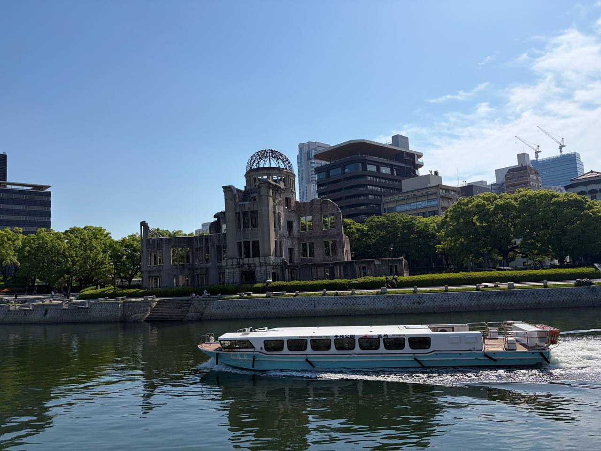
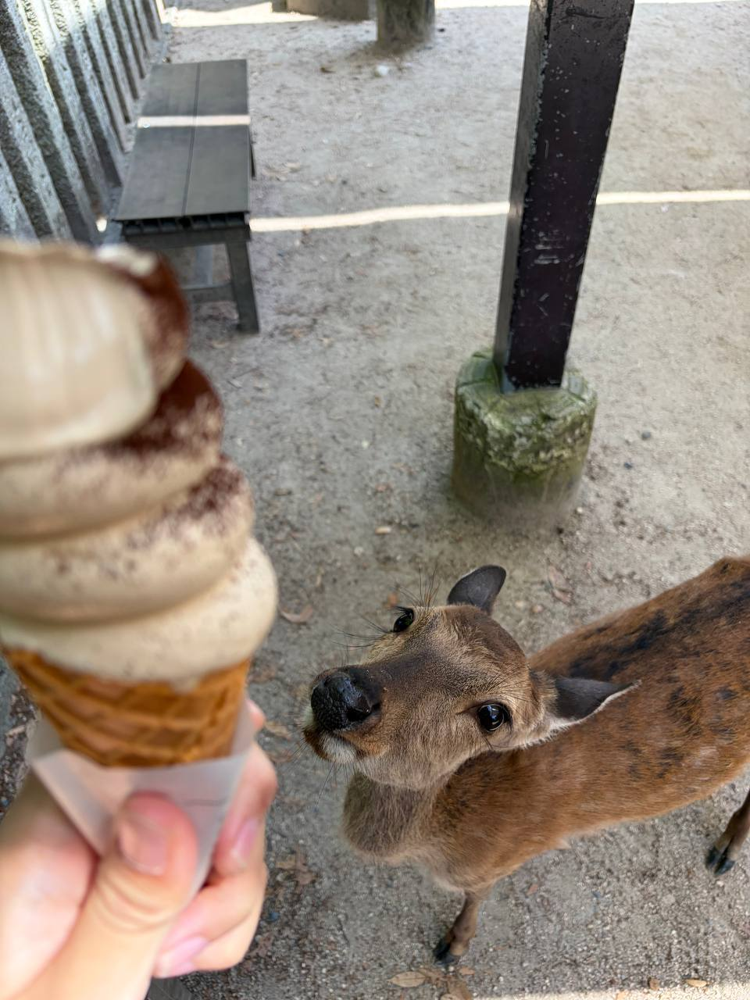

I went to Japan earlier this year! It was from 17 May 2026 to 11 June 2026. What an adventure of my life! I created a website for my Japan travel, here is the [link](https://japan.nknguyenhc.net/)

And so I thought, since this time I am going solo again, why not creating a website for me to store my precious memory 😄

## Hiroshima

My favourite stop in Japan was Hiroshima, as you can see from the picture: it is the floating Torii gate at Miyajima island.

Hiroshima had a mixture of WWII history and the beautiful Miyajima island. I remember fully enjoying the recount of the history as I walked through the peace museum, as well as the peaceful free-roaming deer in Miyajima.

Last time, I mostly explored Japan on my own, booking virtually no tours. This time in Australia, I changed the style: I booked quite a handful of experiences. Looking forward to all the fun activities!
